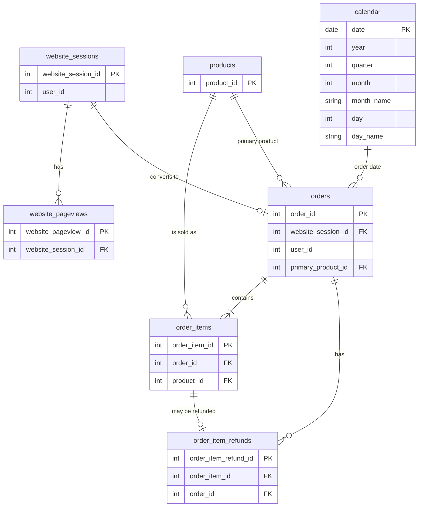

# Toy Store E-Commerce Database Analysis

> SQL analysis of an online toy store's website traffic, orders, products and refunds using **PostgreSQL**.


---

## Project Overview

An end-to-end e-commerce analytics project using PostgreSQL, SQL, and Power BI to investigate sales performance, website traffic, marketing effectiveness, product profitability, refunds, and customer behaviour.

The database contains **7 related tables** covering the full customer journey: **Calender table → website session → website pageviews → products → order → order items → order item refunds**.

**Objective:** To transform raw e-commerce data into actionable business insights that support performance monitoring and help identify opportunities for improvement.

---

## Business Problem

The management team wants to know:

### Business problems and how your dashboard helps:
- Overall performance is unclear.
- Marketing effectiveness is unknown.
- Product performance varies.
- Customer behaviour is poorly understood.
- Refunds affect profitability.
- Desktop and mobile performance may differ.

### Executive Overview:
- How much revenue and profit is the business generating?
- How many orders and customers does it have?
- What is the average order value?

### Traffic & Marketing:
- Which marketing sources generate the most traffic?
- Which sources generate the most revenue?
- Does conversion differ between desktop and mobile?
- Are some channels attracting visitors without generating enough orders?

### Product & Refunds:
- Which products contribute the most revenue and profit?
- Which products have the highest refund rates?
- Which products should be investigated for potential performance or quality issues?

### Customer Analysis:
- Who are the highest-value customers?
- How much revenue does the average customer generate?
- Which customers may be inactive and worth investigating for re-engagement?

---

## Dataset

| Detail | Information |
|---|---|
| **Name** | Toy Store E-Commerce Database (Maven Analytics – Fuzzy Factory) |
| **Source** | [Maven Analytics Data Playground](https://mavenanalytics.io/data-playground) *(update link if different)* |
| **Format** | CSV files loaded into PostgreSQL |
| **Tables** | 7 |

---

## Database Schema & Relationships

### Tables

| Table | Description | Primary Key | Foreign Key(s) |
|---|---|---|---|
| `website_sessions` | One row per website visit (traffic source, device, repeat visit) | `website_session_id` | `user_id` |
| `website_pageviews` | Every page viewed within a session | `website_pageview_id` | `website_session_id` |
| `orders` | One row per customer order | `order_id` | `website_session_id`, `user_id`, `primary_product_id` |
| `order_items` | Individual products inside each order | `order_item_id` | `order_id`, `product_id` |
| `order_item_refunds` | Refunds issued against order items | `order_item_refund_id` | `order_item_id`, `order_id` |
| `products` | Product catalog | `product_id` | – |
| `Celender_Table` | Defining date range | `Date` | – |


### Entity Relationship Diagram



### Relationship Summary

- One **session** can have many **page views**.
- One **session** can lead to at most one **order**.
- One **order** can have many **order items**.
- One **product** can appear in many **order items**.
- One **order item** can have at most one **refund**.

---

## Tools & Skills Used

**Tools**
- Excel
- PostgreSQL / pgAdmin
- Power Bi
- GitHub

**SQL Skills Demonstrated**
- Database and Schema Design: Created multiple relational tables with proper data types, PRIMARY KEY constraints, BIGSERIAL auto-incrementing IDs, and foreign key relationships (REFERENCES).
- Data Validation & Cleaning Checks: Queried tables to audit and check for missing values or nulls (IS NULL) across primary attributes and foreign keys.
- Multi-Table Joins: Combined data across related tables using INNER JOIN and LEFT JOIN to stitch together sessions, orders, order items, refunds, and products.
- Aggregations & Conditional Grouping: Leveraged GROUP BY alongside aggregate functions (SUM, COUNT, AVG, MIN, MAX) and filtered aggregated results using HAVING.
- Common Table Expressions (CTEs): Structured complex queries using WITH clauses for clean, readable multi-step logic (e.g., ranking user orders and product performances).
- Subqueries: Implemented nested subqueries (such as calculating metrics against overall averages inside HAVING clauses).
- Advanced Window Functions: Utilized analytic functions including ROW_NUMBER(), RANK(), DENSE_RANK(), and LAG() with PARTITION BY and ORDER BY clauses.
- Running Totals & Cumulative Metrics: Calculated cumulative/running revenue over time using window frames (OVER (ORDER BY ...)).
- Conditional Logic: Performed customer tier classification and segmentation using CASE WHEN statements.
- Date Manipulation: Extracted and grouped trends over time using date truncation functions like DATE_TRUNC('month', created_at).   

---

## Project Workflow

1. Understand the Data: Review the data dictionary, understand each CSV file, identify key columns, and determine relationships between tables.
2. Database Design: Create the PostgreSQL database and define tables with appropriate data types, primary keys, foreign keys, and constraints.
3. Data Loading: Import the CSV datasets into PostgreSQL and verify successful data ingestion.
4. Data Profiling & Quality Checks: Validate row counts, null values, duplicates, date ranges, key uniqueness, and referential integrity.
5. Exploratory Data Analysis (EDA): Explore the dataset using SQL to understand sales, customer behaviour, website traffic, product performance, and refund patterns.
6. Business Question Definition: Identify key business problems and translate them into measurable analytical questions and KPIs.
7. SQL-Based Business Analysis: Write SQL queries using joins, aggregate functions, CTEs, subqueries, conditional logic, and window functions where appropriate to answer the business questions.
8. Power BI Data Preparation: Connect Power BI to PostgreSQL, transform and clean data using Power Query, and prepare the required tables for analysis.
9. Data Modeling & DAX: Establish relationships between tables, define appropriate measures, and calculate business KPIs such as revenue, profit, average order value, and conversion rate.
10. Dashboard Development: Build interactive Power BI dashboards covering Executive Overview, Traffic & Marketing, Product & Refunds, and Customer Analysis.
11. Insights & Recommendations: Interpret the analytical results, identify business trends and potential improvement opportunities, and recommend data-driven actions.
12. Documentation & Portfolio Publishing: Document the project workflow, SQL queries, data model, dashboard screenshots, key findings, and recommendations on GitHub.

---

## Power BI Dashboard

The dashboard consists of four analytical sections:

### 1. Executive Overview


### 2. Traffic & Marketing


### 3. Product & Refunds


### 4. Customer Analysis


---

## Business Questions Answered

### 1. Which customers generated the highest total revenue,and how many orders did each customer place?
```sql
Select
	user_id,
	sum(price_usd) as Total_Revenue,
	count(order_id) as Total_Orders
from orders
group by user_id
order by Total_Revenue desc;
```

### 2. Which customers have spent more than the average customer revenue?
```sql
Select
	user_id,
	sum(price_usd) as Total_Revenue
from orders
group by user_id
having sum(price_usd) >
(
	Select avg (Customer_Revenue)
	from
	(
		Select
			user_id,
			sum(price_usd) as Customer_Revenue
		from orders
		group by user_id
	) as Customer_Total
)
order by Total_Revenue desc;
```

### 3. Which products generated the highest:
-- Revenue 	
-- Profit
-- Number of Orders
```sql
select
    p.product_id,
    p.product_name,
    count(distinct(oi.order_id)) as total_orders,
    sum(oi.price_usd) as total_revenue,
    sum(oi.price_usd - oi.cogs_usd) as total_profit
from products p
inner join order_items oi
    on p.product_id = oi.product_id
group by p.product_id, p.product_name
order by total_revenue desc;
```

### 4. Find products where revenue is above the average product revenue AND they have refunds.
```sql
select
    p.product_id,
    p.product_name,
    sum(oi.price_usd) as overall_revenue
from products p
inner join order_items oi
    on p.product_id = oi.product_id
inner join order_item_refunds r
    on oi.order_item_id = r.order_item_id
group by p.product_id, p.product_name
having sum(oi.price_usd) >
(
    select avg (total_revenue)
    from
    (
        select
            oi.product_id,
            sum(oi.price_usd) as total_revenue
        from order_items oi
        group by oi.product_id
    ) as average_revenue
)
order by overall_revenue desc;
```

### 5. Which utm_source generates:
-- Most Sessions 	
-- Most Orders
-- Highest Revenue
-- Highest Average

```sql
select
	ws.utm_source,
	count(distinct(ws.website_session_id)) as Total_Sessions,
	count(distinct(o.order_id)) as Total_Orders,
	sum(o.price_usd) as Total_Revenue,
	avg(o.price_usd) as Average_Revenue	
from orders o
left join website_sessions ws
	on o.website_session_id = ws.website_session_id
group by ws.utm_source
order by Total_Revenue desc, Average_Revenue desc;
```

### 6. Which device type has the highest session-to-order conversion rate?
```sql
Select
	ws.device_type,
	count(distinct (ws.website_session_id)) as Total_Sessions,
	count(distinct (o.order_id)) as Total_Orders,
	count(distinct (o.order_id)) * 100 / count(distinct (ws.website_session_id)) as Conversion_Rate
from website_sessions ws
left join orders o
	on o.user_id = ws.user_id
group by ws.device_type
order by Conversion_Rate desc;
```

### 7. Compare repeat sessions vs non-repeat sessions based on:
-- Sessions
-- Orders
-- Revenue
-- Conversion Rate
```sql
select
    ws.is_repeat_session,
    count(distinct ws.website_session_id) as total_sessions,
    count(distinct o.order_id) as total_orders,
    coalesce(sum(o.price_usd), 0) as total_revenue,
    count(distinct o.order_id) * 100.0
        / nullif(count(distinct ws.website_session_id), 0)
        as conversion_rate
from website_sessions ws
left join orders o
    on ws.website_session_id = o.website_session_id
group by ws.is_repeat_session
ORDER BY ws.is_repeat_session;
```

### 8. Find each customer's first order date and first order amount.
```sql
with Customer_Order as
(
Select
	user_id,
	created_at,
	price_usd,
	row_number() over(
	partition by user_id
	order by created_at asc
	) as Order_Rank
from orders
)

Select
	user_id,
	created_at as First_Date,
	price_usd as First_Order
from Customer_Order
where Order_Rank = 10;
```

### 9. Find the top 2 products by revenue within each product category.
```sql
with Product_Table as
(
select
	p.product_id,
	p.product_name,
	sum(oi.price_usd) as Total_Revenue,
	row_number() over (
	partition by p.product_name
	order by sum(oi.price_usd) desc
	) as Product_Rank
from order_items oi
inner join products p
	on oi.product_id = p.product_id
group by p.product_id, p.product_name
)

select *
from Product_Table
where Product_Rank <= 2
order by Product_Rank;
```

### 10. Compare repeat sessions vs non-repeat sessions based on:
-- User_id
-- Order_Date
-- Order_Amount
-- Previous_Order_Amount
-- Difference_Order_Amount_From_Previous
```sql
with Order_Table as
(
Select
	user_id,
	created_at as Order_Date,
	price_usd as Order_Amount,
	lag(price_usd) over (
	partition by user_id
	order by created_at 
	) as Previous_Order_Amount
from orders
)

Select
	user_id,
	Order_Date,
	Order_Amount,
	Previous_Order_Amount,
	Order_Amount - Previous_Order_Amount as Order_Difference	
from Order_Table
order by user_id, Order_Date;
```

### 11. Customer Segmentation: Classify customers.
```sql
Select 
	user_id,
	sum(price_usd) as Revenue,
	case
		when sum(price_usd) >= 1000000 then 'Preimum'
		when sum(price_usd) >= 100000 then 'High'
		when sum(price_usd) >= 50000 then 'Medium'
		else 'Low'
	end as Customer_Classification
from orders
group by user_id
order by Revenue desc;
```

### 12. Rank customers by revenue.
```sql
Select 
	user_id,
	sum(price_usd) as Revenue,
	rank() over(
	order by sum(price_usd) desc
	) as Customer_Rank
from orders
group by user_id;

or 

Select 
	user_id,
	sum(price_usd) as Revenue,
	dense_rank() over(
	order by sum(price_usd) desc
	) as Customer_Rank
from orders
group by user_id;
```

### 13. Show cumulative revenue over time.
```sql
Select
	created_at as Date,
	sum(price_usd) as Daily_Revenue,
	sum(sum(price_usd)) over (
	order by created_at
	) as Running_Revenue
from orders
group by created_at
order by Date;
```

### 14. Find customers who:
-- Have generated significant revenue
-- But haven't purchased recently
```sql
Select
	user_id,
	sum(price_usd) as Total_Revenue,
	max(created_at) as Last_Purchase_Date
from orders
group by user_id
having sum(price_usd) > 500
	and max(created_at) < '2026-07-01'
order by Total_Revenue desc;
```

### 15. Calculate:
-- Product
-- Revenue
-- Refund Amount
-- Refund %
```sql
Select
	count(distinct oi.product_id) as Total_Products,
	sum(oi.price_usd) as Total_Revenue,
	sum(oir.refund_amount_usd) as Total_Refund_Amount,
	round(
		sum(oir.refund_amount_usd) * 100
		/ nullif(sum(oi.price_usd),0),2
	) as Refund_Percentage
from order_items oi
left join order_item_refunds oir
	on oi.order_item_id = oir.order_item_id;
```

### 16. Identify which marketing source ultimately generates the most revenue for each product.
```sql
select
    ws.utm_source,
    p.product_name,
    sum(oi.price_usd) as total_revenue
from orders o
inner join order_items oi
    on o.order_id = oi.order_id
inner join products p
    on oi.product_id = p.product_id
inner join website_sessions ws
    on o.website_session_id = ws.website_session_id
group by ws.utm_source, p.product_name
order by p.product_name, total_revenue desc;
```

### 17. Rank utm_source by total revenue and show:
```sql
select
	ws.utm_source,
	sum(o.price_usd) as Total_Revenue,
	rank() over(
	partition by ws.utm_source
	order by sum(o.price_usd)
	) as Rank_UTM_Source
from website_sessions ws
inner join orders o
	on ws.user_id = o.user_id
group by ws.utm_source
order by Total_Revenue desc;
```
---

## Key Insights

> Fill this in after running your queries. Use real numbers from your results.

1. **Sales Performance:** *Analyzed overall revenue, profit, orders, average order value (AOV), and sales trends.*
2. **Marketing Performance:** *Compared traffic sources based on website sessions, orders, revenue, and conversion rates.*
3. **Device Analysis:** *Evaluated desktop and mobile traffic to identify differences in conversion performance.*
4. **Product Performance:** *Identified high-revenue and high-profit products and analyzed product-level refunds.*
5. **Customer Segmentation:** *Classified customers based on spending behaviour and identified high-value customers.*
6. **Customer Retention:** *Identified high-spending customers who had not purchased recently, highlighting potential retention opportunities.*
7. **Repeat Behaviour:** *Compared repeat and non-repeat sessions to understand purchasing patterns.*

---

## Business Recommendations

1. **Marketing Optimization:** *Prioritize marketing channels based on revenue and conversion performance, not just traffic volume.*
2. **Conversion Improvement:** *Investigate customer journey friction across desktop and mobile platforms.*
3. **Product Optimization:** *Review low-performing and high-refund products to identify potential quality or pricing issues.*
4. **Customer Retention:** *Develop targeted re-engagement campaigns for high-value inactive customers.*
5. **Customer Loyalty:** *Introduce loyalty programs and personalized offers to encourage repeat purchases.*
6. **Profitability Improvement:** *Focus on products and customer segments that contribute stronger profitability.*
7. **Performance Monitoring:** *Use the Power BI dashboard for regular business reviews and data-driven decision-making.*

---

## Repository Structure

```
Toy_Store_E-Commerce_Database/
│
├── 01_schema/
│   └── create_tables.sql
│
├── 02_data_loading/
│   └── load_data.sql
│
├── 03_cleaning/
│   └── data_quality_checks.sql
│
├── 04_analysis/
│   ├── traffic_and_conversion.sql
│   ├── website_funnel.sql
│   ├── orders_and_revenue.sql
│   ├── products_and_refunds.sql
│   └── customer_behavior.sql
│
├── 05_power_bi/
│   │
│   ├── Toy_Store_E-Commerce_Dashboard.pbix
│   │
│   ├── screenshots/
│   │   ├── 01_executive_overview.png
│   │   ├── 02_traffic_and_marketing.png
│   │   ├── 03_product_and_refunds.png
│   │   └── 04_customer_analysis.png
│   │
│   └── documentation/
│       ├── data_model.png
│       └── dax_measures.md
│
├── 06_documentation/
│   ├── business_problem.md
│   ├── business_insights.md
│   └── data_dictionary.md
│
├── images/
│   ├── erd.png
│   └── query_results.png
│
└── README.md
```

---

## How to Run This Project

1. **Install** PostgreSQL and pgAdmin (or DBeaver).
2. **Download** the dataset CSV files from the [source](#-dataset).
3. **Create a database:**
   ```sql
   CREATE DATABASE toy_store;
   ```
4. **Create the tables:** run `01_schema/create_tables.sql`.
5. **Load the data:** update the file paths in `02_data_loading/load_data.sql` and run it.
6. **Check data quality:** run `03_cleaning/data_quality_checks.sql`.
7. **Run the analysis queries** in `04_analysis/`.

---

## Author

**Gitesh Soni**
Business Analyst | Product Analyst | Data & BI Analyst

- 📧 [Email](mailto:giteshsoni2@gmail.com)
- 💼 [LinkedIn](https://www.linkedin.com/in/giteshsoni)
- 🎨 [Behance](https://www.behance.net/giteshsoni)
- 🐙 [GitHub](https://github.com/giteshsoni24)
- 📸 [Instagram](https://www.instagram.com/growwithgitesh/)

---

⭐ If you found this project useful, feel free to star the repository. Thank you for watching.
